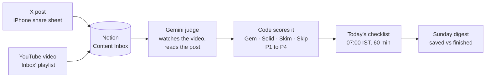

**Content Inbox** · Personal tool by Rishul Nayak · November 2026 · Costs ₹0 to run

# Save a video or post in 2 taps, and a free AI judge decides if it deserves your time

- **Saved links pile up** in a chat-to-self and X bookmarks → every save lands in one Notion database with its date
- **Half of it is hype** or recycled advice → Gemini watches the actual video, not the title, and scores it
- **Nothing gets finished** → each morning it plans a 60-minute checklist from the best items

## How an item gets its verdict

Gemini scores 5 things from 0 to 5. **The code, not the AI, turns them into a verdict**, so the rules stay fixed and easy to tune.

| Score | 5 means | 0 means |
|---|---|---|
| **Timeless** | Principles, still true in 5 years | News, this week's tool |
| **Substance** | Real numbers, worked examples | Vague motivation, fluff |
| **Credibility** | Proven practitioner, checkable claims | Course seller, uncheckable results |
| **Relevance** | Core to one of my focus areas | Unrelated |
| **Actionability** | Clear steps for this week | Nothing to do |

- **Quality** = 2 × average(Timeless, Substance, Credibility), minus 1 per serious red flag (for example "No evidence" or "Clickbait")
- **Verdict**: **Gem** at quality 8+ with relevance 3+ · **Solid** at 6+ · **Skim** at 4+ · else **Skip**
- **Priority score** = 45% quality + 35% relevance + 20% actionability → **P1** at 0.80+, **P2** at 0.65+, **P3** at 0.45+
- **It learns**: when I disagree, I set "My Rating". The judge reads my last 10 disagreements before every run.

All cut-offs live in [`config.yaml`](config.yaml); the judge's instructions live in [`rubric.md`](rubric.md).

## What it costs to run

- **GitHub Actions** (private repo) runs it twice a day: **~150 of 2,000** free minutes a month
- **Gemini `gemini-3.8-flash`** watches videos: **18 of ~20** free requests a day
- **Gemini `gemini-3.5-flash-lite`** reads X posts 10 at a time and backs up the main model: **~500** free requests a day
- **YouTube Data API** and **FxTwitter** fetch video details and full X threads: **under 10 of 10,000** units a day, and no key for X
- **Notion API `2026-03-11`** stores everything on the free plan

When the main model's daily quota runs out, videos switch to the backup model; nothing is lost. Videos over 85 minutes are watched in agentic mode (the model jumps to the parts it needs); over 4 hours they are judged from title, description and chapters. If Gemini is busy, the item waits for the next run (up to 3 tries). Free-tier limits as of November 2026; Google can change them.

## Run it yourself

1. Add 3 repository secrets: `GEMINI_API_KEY`, `YOUTUBE_API_KEY`, `NOTION_TOKEN`.
2. Put your Notion database ID and YouTube playlist ID in [`config.yaml`](config.yaml) under `ids`.
3. Actions → **Content Inbox pipeline** → Run workflow → mode `test-urls` with one YouTube link and one X link.

Full setup, the iPhone Shortcut, and what to do when a run fails: [docs/SETUP.md](docs/SETUP.md).

Code: **`pipeline.py`** collects, judges and plans · **`judge.py`** talks to Gemini · **`scoring.py`** and **`planner.py`** hold the rules · **`digest.py`** writes the Sunday page · **`tests/`** has 37 tests that run on every push.
